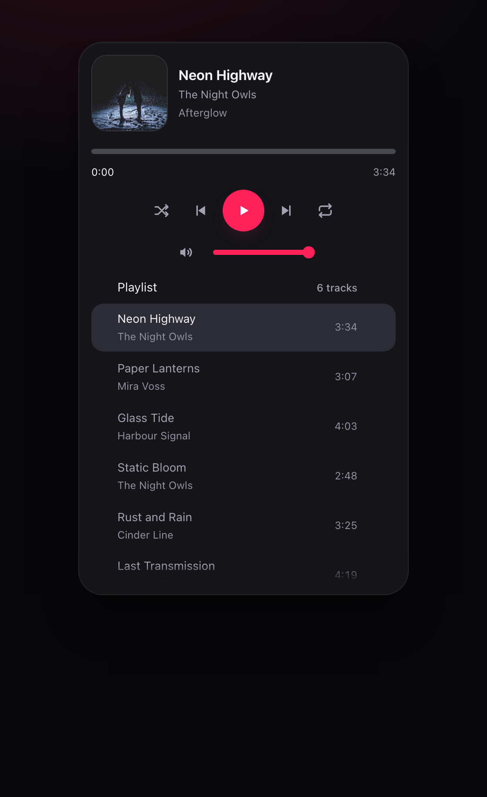
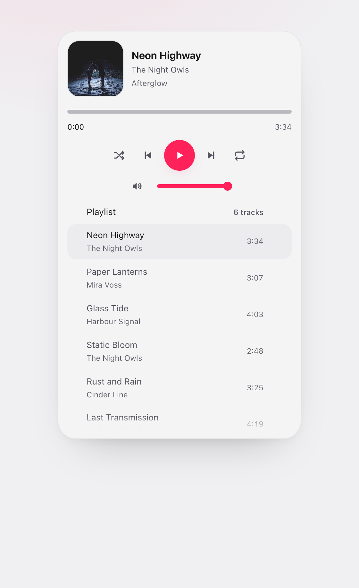

# Soundline

[](https://github.com/nickkupriyanov/soundline/actions/workflows/ci.yml)
[](./LICENSE)

A modern, accessible audio player for React — **single track and playlist** — in one
drop-in component.

- 🌘 **Dark theme by default**, light theme included, both driven by plain CSS variables.
- 🧩 **Bring your own tracks** — one small `adapter` interface for the track source
  and one `engine` interface for playback. No vendor lock-in, no iframe.
- 🫧 **Soft animations out of the box** (pure CSS, zero runtime) with an optional
  [Motion](https://motion.dev) entry point for spring transitions.
- 🌍 **Locales done properly** — `en`/`ru` copy shipped, any tag works, `messages`
  overrides any single string.
- ♿ **Accessible by default** — the seek bar and volume are real ARIA sliders with full
  keyboard control, every queue row is reachable and removable by keyboard, track changes
  and play/pause are announced through a live region, and reduced motion is honoured.
- 📦 **Tiny**, with no third-party runtime dependencies.



---

## Install

```bash
pnpm add @nickkupriyanov/soundline-react
```

`react` and `react-dom` (`^18.2 || ^19`) are peer dependencies. `motion` is optional
and only needed for the `/motion` entry point.

The flow, the helpers, the copy, the class names and the stylesheet live in
**`@nickkupriyanov/soundline-core`** — the framework-free half of Soundline, published
separately so another binding can reuse it. The React package depends on it, so you
normally never install it by hand.

## Quick start

```tsx
import { Player, createStaticAdapter } from '@nickkupriyanov/soundline-react';
import '@nickkupriyanov/soundline-react/styles.css';

const tracks = [
  { id: 'alpha', title: 'Alpha', artist: 'One', album: 'First', src: '/audio/alpha.mp3' },
  { id: 'beta', title: 'Beta', artist: 'Two', src: '/audio/beta.mp3' },
];

export function App() {
  return <Player adapter={createStaticAdapter(tracks)} />;
}
```

That is the whole setup: the widget loads the list, selects the first track, and plays it
through an `HTMLAudioElement` created on the first play. The stylesheet import is not
optional — the component ships classes, not inline styles.

Every value can be controlled instead of left to the player:

```tsx
const [playing, setPlaying] = useState(false);

<Player
  adapter={adapter}
  playing={playing}
  onPlayingChange={setPlaying}
  theme="light"
  locale="ru"
  layout="compact"
/>;
```

## Wiring a real backend

Two small interfaces are all a backend has to satisfy. The track source:

```tsx
import { Player, PlaybackError, type TrackSourceAdapter } from '@nickkupriyanov/soundline-react';

const adapter: TrackSourceAdapter<{ songId: string }> = {
  // Called once per playlist; `signal` is aborted when the playlist is replaced, so
  // pass it straight to `fetch` and ignore the rejection.
  async getTracks({ context, signal }) {
    const response = await fetch(`/api/playlists/${context.key}`, { signal });
    if (!response.ok) {
      throw new PlaybackError({
        code: 'NETWORK_FAILURE',
        message: `Playlist ${context.key} failed with ${response.status}`,
      });
    }

    const payload = await response.json();
    return payload.songs.map((song: { id: string; name: string; artist: string }) => ({
      id: song.id,
      title: song.name,
      artist: song.artist,
      data: { songId: song.id },
    }));
  },

  // Optional, and the reason a listing can stay URL-free: resolved on demand, so a
  // signed or expiring URL never sits in the queue.
  async resolveSource(track, { signal }) {
    const response = await fetch(`/api/songs/${track.data?.songId}/url`, { signal });
    if (!response.ok) throw new PlaybackError({ code: 'SOURCE_UNAVAILABLE', message: 'No URL' });
    const { url, duration } = await response.json();
    return { src: url, duration };
  },
};

<Player adapter={adapter} mediaSession />;
```

The playback backend is `PlaybackEngine`. The default is a lazy `HTMLAudioElement`, and
that is what you want unless you play through something else — a Web Audio graph, a
streaming SDK, a video element:

```tsx
import { type PlaybackEngine } from '@nickkupriyanov/soundline-react';

<Player adapter={adapter} engine={myEngine} />;
```

`createMockEngine()` is the same interface with no audio hardware behind it — it is what
the tests, the stories and the playground run on.

## Props

| Prop                                                                                                                                      | Type                                       | Default               | What it does                                                                           |
| ----------------------------------------------------------------------------------------------------------------------------------------- | ------------------------------------------ | --------------------- | -------------------------------------------------------------------------------------- |
| `adapter`                                                                                                                                 | `TrackSourceAdapter<TData>`                | —                     | The track source. Required.                                                            |
| `engine`                                                                                                                                  | `PlaybackEngine`                           | lazy `<audio>` engine | The playback backend.                                                                  |
| `initialEngineRef`                                                                                                                        | `EngineState`                              | —                     | Telemetry the server rendered from, for hydration (see below).                         |
| `layout`                                                                                                                                  | `'card' \| 'compact'`                      | `'card'`              | The full card, or the narrow panel without the queue.                                  |
| `theme`                                                                                                                                   | `'dark' \| 'light'`                        | `'dark'`              | Never detected: pass it to go light.                                                   |
| `locale`                                                                                                                                  | `string`                                   | visitor's language    | Copy and `lang`; the first render is always `en`.                                      |
| `messages`                                                                                                                                | `Partial<SoundlineMessages>`               | —                     | Per-string overrides on top of the locale.                                             |
| `seekStep`                                                                                                                                | `number`                                   | `5`                   | Seconds one keyboard seek step moves.                                                  |
| `volumeStep`                                                                                                                              | `number`                                   | `0.05`                | How far a keyboard/step volume change moves, `0..1`.                                   |
| `showQueue`                                                                                                                               | `boolean`                                  | `true`                | Whether the built-in widget renders the playlist.                                      |
| `pauseWhenHidden`                                                                                                                         | `boolean`                                  | `false`               | Pause when the document becomes hidden.                                                |
| `mediaSession`                                                                                                                            | `boolean \| { skipSeconds?: number }`      | `false`               | Claim the browser's own media controls.                                                |
| `queue` / `defaultQueue`                                                                                                                  | `readonly Track[]`                         | —                     | The playlist, controlled or seeded.                                                    |
| `currentTrackId` / `defaultTrackId`                                                                                                       | `string \| null`                           | first track           | The selection, controlled or seeded.                                                   |
| `playing` / `defaultPlaying`                                                                                                              | `boolean`                                  | `false`               | Playback intent, controlled or seeded.                                                 |
| `volume` / `defaultVolume`                                                                                                                | `number`                                   | `1`                   | Level `0..1`, controlled or seeded.                                                    |
| `muted` / `defaultMuted`                                                                                                                  | `boolean`                                  | `false`               | Mute flag, controlled or seeded.                                                       |
| `loop` / `defaultLoop`                                                                                                                    | `'off' \| 'all' \| 'one'`                  | `'off'`               | Repeat mode, controlled or seeded.                                                     |
| `shuffle` / `defaultShuffle`                                                                                                              | `boolean`                                  | `false`               | Shuffle, controlled or seeded.                                                         |
| `rate` / `defaultRate`                                                                                                                    | `number`                                   | `1`                   | Playback speed, controlled or seeded.                                                  |
| `onTrackChange`, `onPlayingChange`, `onVolumeChange`, `onMutedChange`, `onLoopChange`, `onShuffleChange`, `onRateChange`, `onQueueChange` | callbacks                                  | —                     | What the application asked for, with `{ contextKey, reason }` (`user` or `automatic`). |
| `onProgress`                                                                                                                              | `(seconds, { duration, trackId }) => void` | —                     | The throttled playhead, with the final value on pause and seek.                        |
| `onPlay`, `onPause`, `onEnded`, `onError`                                                                                                 | callbacks                                  | —                     | What the engine actually did.                                                          |
| `className`                                                                                                                               | `string`                                   | —                     | Extra class on the outermost element.                                                  |
| `classNames`                                                                                                                              | `Partial<Record<SnClassSlot, string>>`     | —                     | Per-slot class overrides, added alongside the library's own.                           |
| `components`                                                                                                                              | `SoundlineComponents`                      | —                     | Replace individual parts of the widget.                                                |
| `animations`                                                                                                                              | `AnimationKit`                             | `cssAnimations`       | Replace the animation layer.                                                           |
| `autoFocus`                                                                                                                               | `boolean`                                  | `false`               | Move focus into the widget on mount.                                                   |

Passing a controlled prop (`queue`, `playing`, …) fixes that value for the life of the
component: the widget reports the change and waits for the new value to arrive. Passing
only the `default*` twin seeds the initial value and lets the player own it afterwards.

Headless users never mount the widget: `usePlayerFlow({ adapter })` returns the same
`{ snapshot, actions }` the widget renders from.

## Classes

Every element the widget draws has a stable base class, and every base class has a slot
name you can target from `classNames`:

| Slot                                                       | Class                                                                         | Where                                                        |
| ---------------------------------------------------------- | ----------------------------------------------------------------------------- | ------------------------------------------------------------ |
| `root`                                                     | `.sn-root`                                                                    | Outer element; carries `data-sn-*` and the custom properties |
| `card`                                                     | `.sn-card`                                                                    | The card (or the compact panel)                              |
| `nowPlaying`                                               | `.sn-now-playing`                                                             | The artwork and the labels beside it                         |
| `artwork`                                                  | `.sn-artwork`                                                                 | The artwork box (remounted on every track change)            |
| `artworkFallback`                                          | `.sn-artwork-fallback`                                                        | What shows when the image is missing or broken               |
| `trackInfo`                                                | `.sn-track-info`                                                              | The text column next to the artwork                          |
| `title` / `artist` / `album`                               | `.sn-title` / `.sn-artist` / `.sn-album`                                      | The now-playing lines                                        |
| `progress`                                                 | `.sn-progress`                                                                | The progress group: the seek bar and its time readout        |
| `controls`                                                 | `.sn-controls`                                                                | The controls group: the transport and the volume row         |
| `transport`                                                | `.sn-transport`                                                               | The control row                                              |
| `playButton` / `previousButton` / `nextButton`             | `.sn-play-button` / `.sn-previous-button` / `.sn-next-button`                 | The transport buttons                                        |
| `shuffleButton` / `repeatButton`                           | `.sn-shuffle-button` / `.sn-repeat-button`                                    | The two toggles                                              |
| `seek`                                                     | `.sn-seek`                                                                    | The seek bar (the slider element)                            |
| `seekTrack` / `seekBuffered` / `seekFill` / `seekThumb`    | `.sn-seek-track` / `.sn-seek-buffered` / `.sn-seek-fill` / `.sn-seek-thumb`   | The layers of the seek bar                                   |
| `timeDisplay` / `currentTime` / `totalTime`                | `.sn-time-display` / `.sn-current-time` / `.sn-total-time`                    | The readout                                                  |
| `volume` / `volumeButton` / `volumeSlider` / `volumeThumb` | `.sn-volume` / `.sn-volume-button` / `.sn-volume-slider` / `.sn-volume-thumb` | The volume control                                           |
| `volumeValue`                                              | `.sn-volume-value`                                                            | The percentage hint (not a tab stop; shown on drag or focus) |
| `queue`                                                    | `.sn-queue`                                                                   | The queue, drawn as part of the card (no panel of its own)   |
| `header`                                                   | `.sn-header`                                                                  | The queue's header row                                       |
| `queueCount`                                               | `.sn-queue-count`                                                             | The track counter, as muted text                             |
| `queueList`                                                | `.sn-queue-list`                                                              | The `<ul>` of rows (scrolls under `--sn-queue-max-height`)   |
| `trackItem`                                                | `.sn-track-item`                                                              | A row: the layout of the two buttons                         |
| `trackSelect`                                              | `.sn-track-select`                                                            | The button that selects the track (the row's content)        |
| `trackItemActive`                                          | `.sn-track-item-active`                                                       | Added to the current row                                     |
| `trackItemPlaying`                                         | `.sn-track-item-playing`                                                      | Added to the playing row                                     |
| `trackLine` / `eq`                                         | `.sn-track-line` / `.sn-eq`                                                   | The title line and the playing bars                          |
| `trackTitle` / `trackArtist`                               | `.sn-track-title` / `.sn-track-artist`                                        | The row's two text lines                                     |
| `trackDuration`                                            | `.sn-track-duration`                                                          | The adapter duration column inside the selecting button      |
| `trackRemove`                                              | `.sn-track-remove`                                                            | The button that removes the row                              |
| `loading` / `empty` / `error`                              | `.sn-loading` / `.sn-empty` / `.sn-error`                                     | The state blocks                                             |
| `live`                                                     | `.sn-live`                                                                    | The polite live region                                       |

```tsx
<Player adapter={adapter} classNames={{ card: 'my-card', trackItem: 'my-row' }} />
```

A slot is an extension point, not a DOM structure: the class is added _next to_ the
library's own, never instead of it. `SN_CLASS` from core is the same mapping as data.

## Theming

The stylesheet is one file of plain CSS custom properties — no Tailwind, no CSS-in-JS,
no build step:

```css
.sn-root {
  --sn-width: 420px;
  --sn-accent: #7c5cff;
  --sn-surface: #101018;
}
```

The player tokens are `--sn-width`, `--sn-width-compact`, `--sn-artwork-radius`,
`--sn-artwork-size`, `--sn-seek-height`, `--sn-seek-fill`, `--sn-track`,
`--sn-queue-max-height`, `--sn-queue-fade`, `--sn-row-max-height`, `--sn-card-gap` and
`--sn-volume-width`; the palette is
`--sn-surface`/`--sn-panel`/`--sn-control`, `--sn-text`/`--sn-text-muted`,
`--sn-accent`, `--sn-border` and `--sn-danger`/`--sn-danger-contrast`. The light theme is
the same set under `[data-sn-theme='light']`, which the widget sets from the resolved theme.

`--sn-artwork-size` is 72px by default, 88px in a full card whose container is at least
340px wide, and 64px in the compact layout. `--sn-volume-width` caps the centred volume
row at 208px: the visible pair is a 32px mute button, an 8px gap and a 124px slider;
the percentage is an absolutely positioned hint outside the flow.
`--sn-track` paints the empty part of the seek and volume bars and is separate from
`--sn-control`, which is the card's own surface in the light theme. `--sn-queue-fade` is
both the queue's bottom fade and its bottom padding, so the last row clears the fade at
the end of the scroll.
`--sn-danger-contrast` is the text colour on a danger fill — dark ink on the light dark-theme
danger, white on the darker light-theme one — and `styles.test.ts` measures both at 4.5:1 or
better.



## Animations

Animations are pure CSS and ship with the stylesheet — no runtime, no extra dependency.
The widget renders through an `AnimationKit`, so a whole animation layer is one prop:

| Primitive  | What it animates                                                                                           |
| ---------- | ---------------------------------------------------------------------------------------------------------- |
| `StepHost` | the artwork on a track change: the new cover steps in from the side the queue moved toward                 |
| `Item`     | a queue row: the stagger of its position, and — for a row removed through the list — its fade and collapse |
| `Height`   | the card, following the height of the content it holds                                                     |

```tsx
import { Player } from '@nickkupriyanov/soundline-react';

<Player adapter={adapter} />; // cssAnimations, the default kit
```

For spring animations use the `/motion` entry point. It needs
[Motion](https://motion.dev) as an **optional** peer; the main entry point never imports
it, so an application that does not opt in never ships it.

```tsx
import { Player } from '@nickkupriyanov/soundline-react/motion';
```

`prefers-reduced-motion: reduce` is honoured everywhere: the stylesheet collapses every
animation, the spring kit drops its durations, and the height is not even measured.
The playing row's equalizer and the sweep across the filled playhead stop with it. A row
removed through the list is dropped at once rather than held for its exit.

## Accessibility

Every control is operable by keyboard, carries a role, a name and the states that belong
to it, and is covered by a test.

| Control         | How it is exposed                                                                           |
| --------------- | ------------------------------------------------------------------------------------------- |
| Play / Pause    | one button; the accessible name swaps (`Play` ⇄ `Pause`) and there is no `aria-pressed`     |
| Previous / Next | buttons, named `Previous track` / `Next track`, disabled when there is nowhere to go        |
| Shuffle         | a toggle (`aria-pressed`)                                                                   |
| Repeat          | a toggle walking `Repeat off` → `Repeat playlist` → `Repeat track`                          |
| Mute            | a toggle whose name says what pressing it does (`Mute` ⇄ `Unmute`)                          |
| Seek bar        | `role="slider"` with `aria-valuemin`/`max`/`now` and the position in words (`0:00 of 1:40`) |
| Volume          | the same slider contract, with the percentage in words                                      |
| Queue row       | two sibling buttons — one selects the track, one removes it — never one inside the other    |
| Playlist        | a labelled list; the current row carries `aria-current`, the rows are walked with arrows    |

Play/pause has no `aria-pressed` on purpose: "Pause, pressed" is a state nobody asked to
hear, and the button's name already says what it will do. The toggles that genuinely have
an on/off state do carry it.

**Announcements.** One polite live region (`role="status"`) speaks one thing at a time, in
order of how much it matters: an error, the end of the playlist, the list still arriving,
an empty list, and otherwise the track itself — `Now playing: {title}` while it plays and
`Paused: {title}` when it stops. The pause goes through the region because the name swap of
an unfocused button is never spoken. A failure says what failed, and every failure
string in the dictionary is one the widget actually renders: a list that could not be
fetched (`queueError`), a format the browser refuses (`unsupportedLabel`), and anything
else that stopped the track (`genericError`). The choice is made once, in core, and
arrives as `view.errorMessage`.

**Focus.** Nothing is focused on mount. When a change removes whatever had the focus — the
row a visitor just deleted, the playhead of the track that failed — the focus is re-homed
inside the card instead of falling to `<body>`, and a focus outside the widget is never
stolen. A keyboard retry is handed to the surviving card _before_ the retry runs, so the
error → loading → error/ready swaps keep the visitor's place: the next `Tab` reaches the new
Retry button after another failure, or the seek bar after a recovery. `autoFocus` is opt-in.

**Keyboard.** `Tab` reaches every control in reading order and leaves the widget again;
arrows, `Home` and `End` move the seek bar, the volume and the queue rows without the focus
escaping. Removing a row is `Enter`/`Space` on its remove button; the row that leaves stays
in the tab order of nothing and is hidden from screen readers while it animates out.

Every string is a key in `messages` (`playerLabel`, `currentTrackLabel`, `pausedTrackLabel`,
`trackLabel`, `removeTrackLabel`, `loadingLabel`, `emptyLabel`, `genericError`, `queueError`,
`endedLabel`, …), so the whole accessible surface can be translated or overridden.

Automated checks run in `pnpm test`: an axe pass (`jest-axe`) over every state the widget can
be in — idle, playing, paused, ended, loading, empty, failures, both themes, compact — fails
the build on any violation, and a token test measures the two caption colours against every
surface they land on, including a playing row's tint (WCAG AA, 4.5:1). The rest of the
palette, and any theme a consumer overrides, is still manual: `jsdom` applies no stylesheet,
and the browser checks look at geometry, focus and reduced motion. See "Scope and known
limits".

## Media Session and background playback

The browser's own controls — the lock screen, the notification shade, the keyboard's media
keys — are claimed only when asked for, through `mediaSession`:

```tsx
<Player adapter={adapter} mediaSession={{ skipSeconds: 15 }} />
```

The widget then publishes the current track (`title`, `artist`, `album`, `artwork`) and the
`playing`/`paused` state, and routes `play`, `pause`, `nexttrack`, `previoustrack`,
`seekbackward`, `seekforward` and `seekto` back to its actions. `skipSeconds` (default `10`)
is the step the skip buttons use, unless the browser hands one of its own. Where the API is
missing — the server, older browsers — or a single action is unsupported, the widget carries
on silently.

`pauseWhenHidden` stops playback when the document becomes hidden. It is off by default, and
nothing resumes on its own when the tab comes back: that stays the application's call.

## Server rendering

The widget's first render never reads the browser, so the markup a server pass produces is
the markup the client hydrates:

- `locale` is a prop, or the visitor's language **after** mounting — the first render uses
  `en` on both sides, and `lang` then switches to the real tag. `theme` is `dark` unless you
  pass it: it is never detected, because a system light theme must not repaint a player the
  application asked to keep dark.
- A server pass fetches nothing and builds no `<audio>`: the controller starts only after
  mounting, and the default engine creates its element on first use.

The playhead is the one value a server pass cannot derive — the engine that owns it lives on
the client. State it explicitly when the first paint should show it, and hand the same object
to the client:

```tsx
import { renderToString } from 'react-dom/server';
import { hydrateRoot } from 'react-dom/client';

const props = {
  adapter,
  // What lets the pass render the transport and the playhead, not the loading state.
  defaultQueue: tracks,
  locale: 'en',
  theme: 'dark',
  // Core's `EngineState`; a controller's `getEngineRef()` returns one.
  initialEngineRef: engineRef,
};

// server
res.send(`<div id="root">${renderToString(<Player {...props} />)}</div>`);

// client
hydrateRoot(document.getElementById('root')!, <Player {...props} />);
```

`initialEngineRef` seeds the first paint only: from `start()` on, the engine owns the
telemetry. `pnpm test` keeps all of this honest — `ssr.test.tsx` renders and hydrates the
widget and fails the build on any recoverable hydration error or console warning.

## Mock engine and adapter

Nothing in the library needs audio hardware to run, which is what makes it testable and what
the Storybook and the playground use:

```tsx
import { createMockAdapter, createMockEngine } from '@nickkupriyanov/soundline-react';

// Deterministic tracks, optional latency, optional injected failures.
const adapter = createMockAdapter({
  tracks: [{ id: 'a', title: 'Alpha', src: 'a.mp3' }],
  failure: 'NETWORK_FAILURE', // makes getTracks fail, for the error state
});

// A virtual playhead: `tickMs` decides how fast it moves, `failures` which source fails.
const engine = createMockEngine({
  duration: 180,
  tickMs: 250,
  failures: { 'a.mp3': 'NOT_SUPPORTED' },
});

<Player adapter={adapter} engine={engine} />;
```

## Development

```bash
pnpm install
pnpm dev              # the React playground (Vite) — controls for theme, locale, layout, state
pnpm preview          # the built playground
pnpm storybook        # the component stories
pnpm build-storybook  # a static Storybook
pnpm test             # vitest
pnpm typecheck        # every package
pnpm build            # core, then the React binding
pnpm screenshot       # Chrome screenshot of a URL into docs/images (see tools/screenshot.mjs)
```

Browser-level checks and packaging verification run against the built playground and
the packed tarballs:

```bash
pnpm build && pnpm --filter @nickkupriyanov/soundline-playground build
pnpm --filter @nickkupriyanov/soundline-playground preview   # serve on :4173
pnpm check:layout     # the card's width in every gallery state (real Chrome)
pnpm check:container  # 280/320/400/800 px, queue scroll, focus, reduced motion
pnpm verify:install   # build + pack core and React, install them in clean React 18/19 apps,
                      # production build, SSR + hydration (Node and a real browser)
pnpm verify:install:leg react-18   # one consumer leg
```

```
packages/core              framework-free core (@nickkupriyanov/soundline-core)
  src/styles               tokens.css → base.css → soundline.css → animations.css
                           (concatenated at build time)
packages/react             the React binding (@nickkupriyanov/soundline-react)
  src/stories              the Storybook stories (widget, states, extensions, headless)
apps/playground            Vite playground + the state gallery (/gallery.html)
tools                      screenshot.mjs (Chrome DevTools Protocol, no extra dependency),
                           check-layout.mjs / check-container.mjs / check-hydration.mjs
                           (real-browser checks) and verify-install.mjs + install-check/
                           (tarball packaging in clean consumer apps)
```

The playground and its gallery run against the sources, so the dev server hot-reloads the
library itself. The gallery at `/gallery.html?theme=light` renders every state the widget
can be in — idle, playing, paused, ended, loading, empty, and both failures — each marked
with `data-sn-case`/`data-sn-state`/`data-sn-layout` for the browser checks.

`verify-install.mjs` is the packaging proof: it builds and `pnpm pack`s both packages,
asserts the packed export maps, the React dependency on core (a real version, never
`workspace:`) and `motion` staying an optional peer, then installs them into React 18 and
React 19 scratch apps in `.verify/` (each with its own npm cache), type-checks them,
builds them for production, hydrates the widget in Node and, finally, hydrates the
prerendered page in a real browser. CI runs the same script — a job that packs the
libraries once, then one independent job per leg.

Releases go through changesets: `pnpm changeset` records a change, and
`.github/workflows/release.yml` turns the recorded changes into a version PR (new versions
and changelogs) that publishes on merge. Publishing needs an `NPM_TOKEN` repository secret:
the workflow passes it as both `NPM_TOKEN` and `NODE_AUTH_TOKEN` — the latter is the variable
`setup-node` writes into `.npmrc`, and it is what npm actually authenticates with. The guard
in `tools/publish.mjs` (`pnpm release:publish`) skips the publish and says so when the secret
is missing, so the version PR still forms. The full contract is in
[`docs/specification.md`](docs/specification.md).

## Scope and known limits

Inside v1: one track and one playlist — play/pause, seek, volume, mute, rate, repeat,
shuffle, next/previous, track selection, optional Media Session, optional hidden-tab pause,
SSR, and accessibility by default.

Deliberately outside v1: waveform, FFT visualisation, drag-and-drop reordering, favourites,
search, streaming-service integration, downloads, and synchronised lyrics.

Honest limits of the current version:

- **Contrast is only partly measured.** A token test checks the caption colours against every
  surface they land on, and now also measures the retry button and each queue-row state
  (resting, hover, selected, playing) against the background it is actually painted on. The
  rest of the palette — and any override a consumer makes — is not (jsdom has no styles, the
  browser checks look at geometry, focus, key component colours and reduced motion). A
  palette change deserves a manual axe run in a browser.
- **The Motion kit does not animate a row leaving the queue.** The CSS kit's exit — a fade
  and a collapse, with the row held in place while the rows below keep their ground — is
  marked `data-sn-motion='true'`-free on purpose, so a kit that animates itself keeps its
  own movement. Removal under Motion is instant, as it was before.
- The collapse of a leaving row starts from a fixed `--sn-row-max-height` (3.5rem): a row
  taller than that still fades, it just collapses from the cap.
- A failed list and a failed track have their own descriptions but share the `errorLabel`
  heading ("Playback error").
- `clearQueue`, a playlist switch and a queue swapped by the application are instant: only
  a removal asked for through the list has an exit.
- The npm badges are absent because the packages are not published yet; the CI and licence
  badges above describe this repository.

## License

MIT © Nick Kupriyanov. The repeat icons come from
[Tabler Icons](https://github.com/tabler/tabler-icons) (MIT); the React package ships the
attribution in [`THIRD-PARTY-LICENSES.md`](packages/react/THIRD-PARTY-LICENSES.md).
